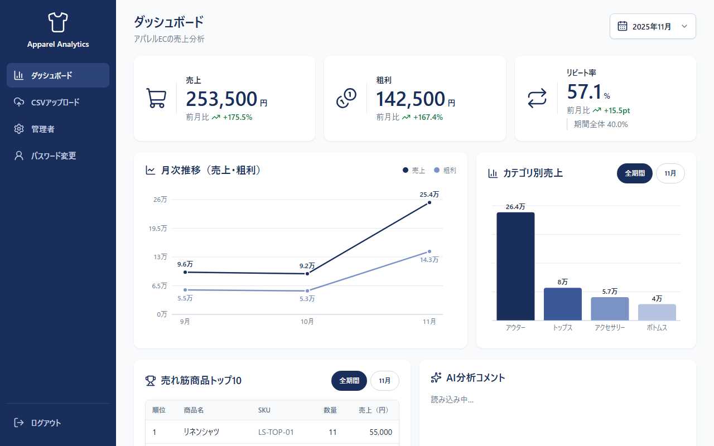
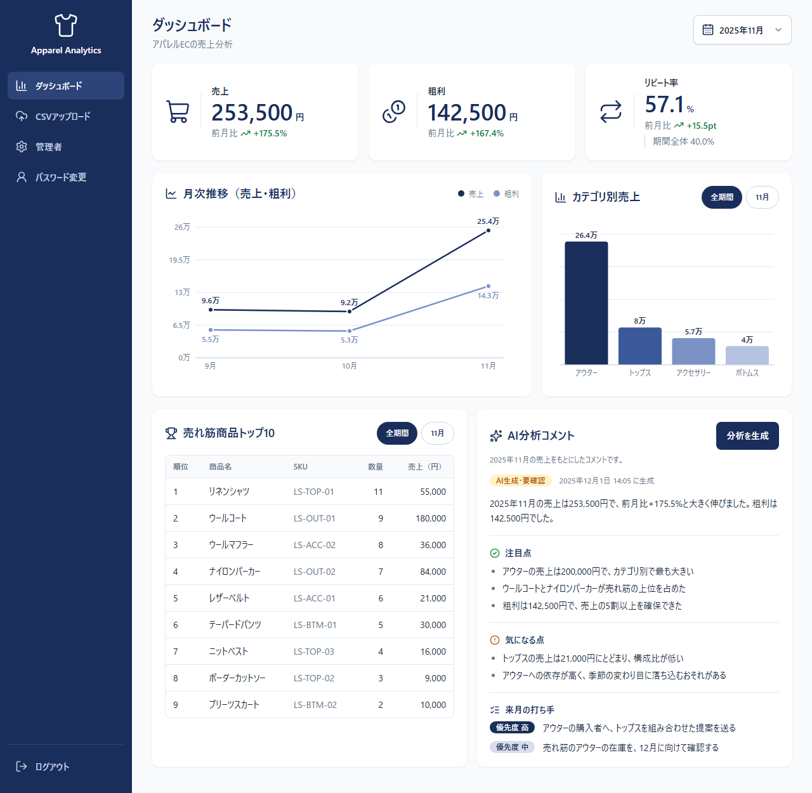
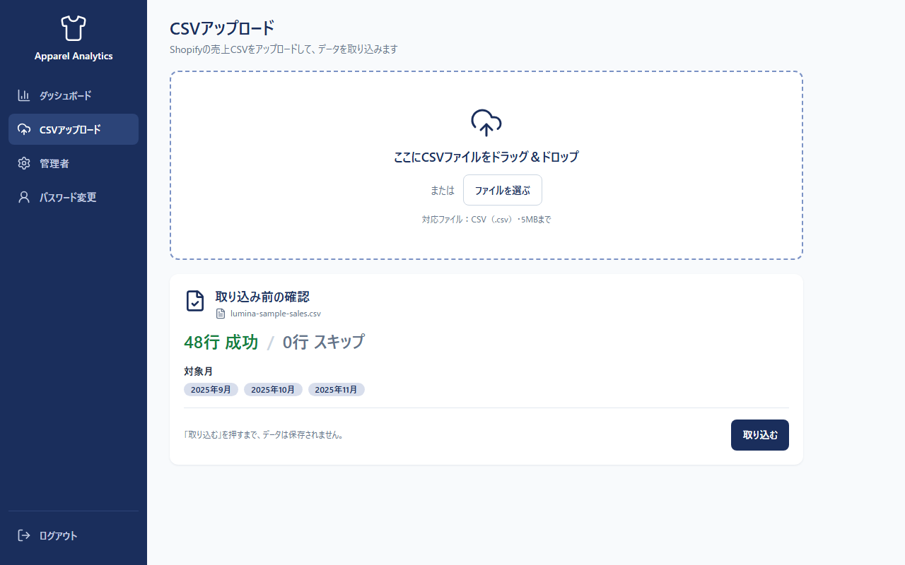
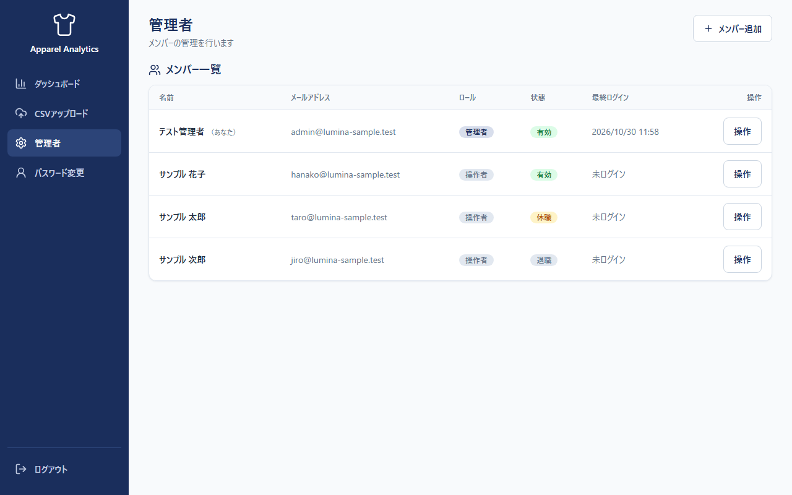

# AI搭載 売上分析ダッシュボード

Shopify の売上 CSV をアップロードすると、3大 KPI（売上・粗利・リピート率）・グラフ・AI 分析コメントがそろう月次レポートを作る Web アプリです。

講座の模擬案件（架空のアパレル EC「LUMINA」のマーケティング担当向け）をもとに作った作品です。実在のお店やクライアントの案件ではありません。
月次報告のためにかかっていた集計と文章づくり（約3時間・想定）を、CSV を入れて内容を確認するだけ（約30分・想定）にすることを目指しました。

このリポジトリには2つのものが入っています。

- ポートフォリオ：ログインなしで試せるデモ版と紹介ページ（LP）
- 納品物：ログイン・お店ごとのデータ分離・管理者画面まで備えた本番版と、その資料

## このリポジトリの地図

| フォルダ | 区分 | 中身 |
|---|---|---|
| README.md | 入口 | このファイル。作品の紹介と、納品物への入口 |
| docs/ | 納品 | 運用マニュアル・CSV の説明書・開発者・保守ガイド（環境変数を含む）・画面画像・印刷用 PDF |
| src/ | 納品 | 本番版のコード（Next.js） |
| supabase/ | 納品 | DB の構造と権限（RLS）の SQL |
| scripts/ | 納品／開発 | `create-first-admin.mts` は最初の管理者を作る（納品）。`seed-test-users.mts` はテスト用（開発） |
| tests/ | 開発 | 開発用（自動テスト）。お客様は見なくてよい。中身の案内は [tests/README.md](tests/README.md) |
| AGENTS.md | 納品 | AI に作業を引き継ぐときの入口 |
| demo/ | ポートフォリオ | デモ版と紹介ページ |
| .github/・package.json などの設定 | 開発 | 自動テスト（CI）・ビルドや Lint の設定 |

---

# ポートフォリオ

## まず試す

| 見るもの | URL |
|---|---|
| デモ（ダミーのデータで試せる） | https://sales-dashboard-lp.vercel.app/demo |
| 紹介ページ | https://sales-dashboard-lp.vercel.app/ |

デモは、閲覧者自身の Gemini（Google の AI）のキーを使います。入れるのは、ダミーのデータだけにしてください（実際の売上データは入れない）。
デモの仕組み・本番版との違いは、[demo/README.md](demo/README.md) にあります。

## 何ができるか

| 機能 | 内容 |
|---|---|
| CSV の取り込み | ドラッグ＆ドロップで取り込み。列名・日付の揺れを吸収し、取り込めない行は理由つきの CSV で受け取れる。同じ月は上書きの確認つき |
| ダッシュボード | 売上・粗利・リピート率（前月比つき）／月次推移／カテゴリ別売上／売れ筋商品トップ10。月と期間（全期間・選んだ月）を切り替え |
| AI 分析コメント | 月ごとに、まとめ・注目点・気になる点・来月の打ち手を生成。数字は集計値と自動で照合し、合わなければ警告。「AI生成・要確認」を必ず表示 |
| アカウント管理 | 管理者がメンバーを追加・休職・退職・ロール変更。一時パスワードは1回だけ表示。管理者の交代にも対応 |
| お店ごとのデータ分離 | 同じお店のメンバーだけがデータを見られる（DB の行レベル制限＋サーバー側の確認の二重の守り） |

画面はパソコン・タブレット・スマートフォンに対応しています。

## 画面

画面は、架空のお店とダミーの CSV で撮ったものです。

ダッシュボード。3つの KPI（前月比つき）と、月次推移・カテゴリ別売上のグラフ。

AI 分析コメント。「AI生成・要確認」の印つきで、まとめ・注目点・気になる点・来月の打ち手が出る。

CSV の取り込み。保存の前に、成功・スキップの行数と対象の月を確認できる。

管理者画面（本番版）。メンバーの追加・休職・退職・ロール変更ができる。

## 作品の見どころ：数字を間違えないための仕組み

このアプリで一番避けたいのは、「止まらずに静かに間違う」ことです（集計のズレ・AI の読み違い）。

| 仕組み | 内容 |
|---|---|
| 集計は1か所 | 集計は `src/lib/aggregate` の関数だけで行い、画面・AI・テストが同じ結果を使う |
| 正解値テスト | 自作の CSV（48行）の数字を、手計算で決めて固定してテスト（9月の売上 95,500 円・10月 92,000 円・11月 253,500 円、期間全体のリピート率 40.0% など）。CI で毎回実行 |
| 取込結果の表示 | 「○行 成功 / ×行 スキップ」を必ず表示し、スキップ行を理由つきで受け取れる |
| AI の数字の照合 | コメントの中の金額・割合を、送った集計値と自動で照合。合わなければ警告を出す |
| 人の確認 | AI コメントは、操作者が確認してから共有する（[運用マニュアル](docs/operations-manual.md)） |
| AI に送るデータ | 集計した数字だけ。顧客 ID や明細の行は送らない |

## 技術構成

| 分類 | 使っているもの |
|---|---|
| フロントエンド | Next.js 16（App Router）・TypeScript・Tailwind CSS 4・Recharts |
| CSV | PapaParse（読み取り）・Zod（行と AI の出力の検証） |
| DB・認証 | Supabase（PostgreSQL・Auth・行レベルセキュリティ） |
| AI | Claude API（本番の想定）・Gemini API（検証）。環境変数 `LLM_PROVIDER` で手動で切り替え（自動フォールバックなし） |
| テスト | Vitest（単体・権限）・Playwright（画面の流れ・スマホ幅） |
| 公開・自動化 | Vercel・GitHub Actions（この公開版は CI のみ） |
| パッケージ管理 | npm（Node.js 24.x） |

## 作り方

- ヒアリング → 提案 → 実装 → 納品の流れで進めました
- 要件定義・設計の判断・動作と数字の確認は自分（usako-ui）が担当し、実装は AI（Claude Code）に要件を伝えて進めました
- 数字の正しさは、手計算の正解値テストと CI で毎回確かめています
- AI の出力は、型の検証と数字の照合で確かめ、最後は人が確認してから使う運用にしました

---

# 納品物

導入をご検討の方・保守担当の方は、ここから資料を開いてください。

| 資料 | 対象 | 内容 |
|---|---|---|
| [運用マニュアル](docs/operations-manual.md) | 操作者・管理者 | 画面の見かた・毎月の手順・AI コメントの扱い・管理者の操作と交代・困ったとき |
| [印刷用 A4 PDF](docs/print/monthly-guide-a4.pdf) | 操作者・管理者 | 毎月の手順・AI コメントの確認・困ったときを、A4 片面1枚にまとめたもの |
| [CSV の形式の説明書](docs/csv-format.md) | 操作者・保守担当 | 必要な列・日付の形式・別名・取り込めないときの直し方 |
| [開発者・保守ガイド](docs/developer-guide.md) | 開発者・保守担当 | 手元での動かし方・テスト・CI・トークンの更新・環境変数の一覧（値は書かない）・管理者がいなくなったときの手順 |
| [AI 引き継ぎ](AGENTS.md) | AI・開発者 | 触ると壊れる所・変更前に読む設計判断 |

講座の配布 CSV は、このリポジトリに含めていません。権利は講座の提供元にあります。
本番版の正解値の確認は、非公開の作業用リポジトリで行っています。公開側の数字の確認は、自作の CSV の正解値で行います（本番版の動作確認：`tests/fixtures/lumina-sample-sales.csv`／デモの見本：`demo/public/sample-sales-demo.csv`）。

手元での起動手順、テストのコマンド、GitHub Actions の説明は、[開発者・保守ガイド](docs/developer-guide.md) を見てください。

## 本番の想定と検証環境の違い

このリポジトリは、検証環境で動かして確かめました。

| 項目 | 本番の想定 | 検証環境 |
|---|---|---|
| AI | Claude API | Gemini API（無料枠。1日に使える回数に上限あり） |
| ホスティング | Vercel Pro | Vercel Hobby（個人・非商用） |
| DB | Supabase（有料プランを想定） | Supabase Free ＋ 毎日1回のアクセスで停止を防ぐ |
| 漏えいしたパスワードの確認 | 有料プランでオン | オフ（無料プランでは使えないため）。代わりにパスワード8文字以上・一時パスワードは16文字のランダム・公開サインアップなしで守る |
| データ | 実際の Shopify CSV | ダミーの CSV だけ（無料枠の入力はサービス改善に使われるため、実データは入れない） |

## このアプリでやらないこと

Shopify API との自動連携・Slack などへの通知・PDF の自動作成とメール配信・複数店舗や複数チャネル・前年同月比・閲覧専用のログインは、今回の範囲に入れていません。メールが使えないため、パスワードの再設定は、管理者による一時パスワードの再発行で行います。

## ライセンス

詳しくは [LICENSE](LICENSE) を見てください。

- 閲覧・参照・学習のための利用はできます
- 商用利用・無断での複製・再配布・これをもとにした製品開発はできません
- 商用や導入のご相談は、[LINE 公式](https://line.me/R/ti/p/@745jejoa)へお願いします
