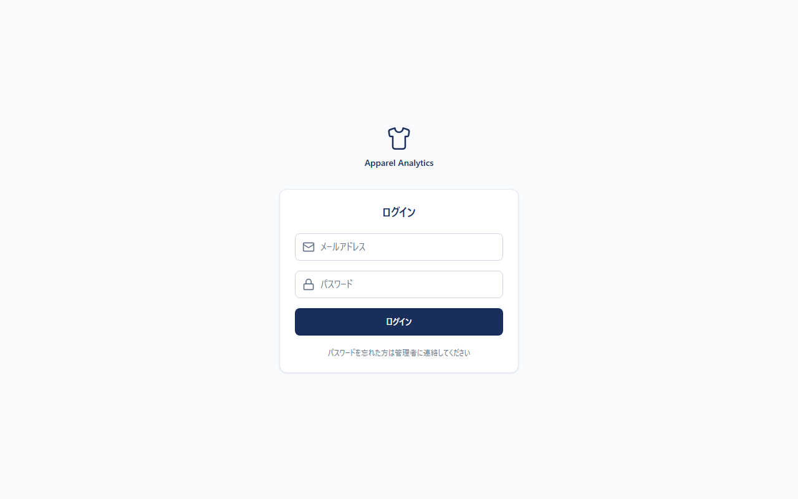
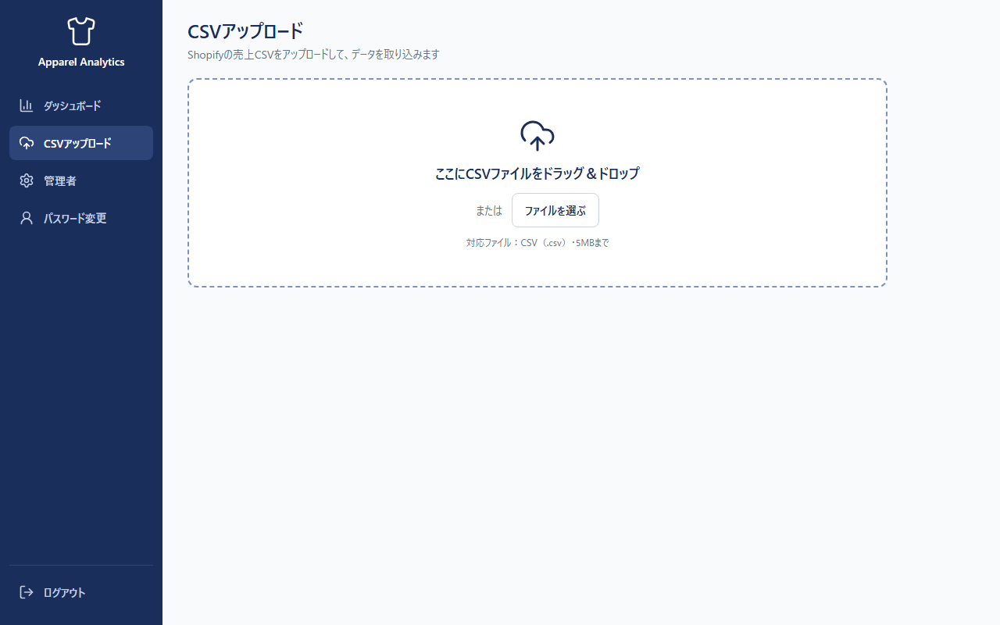
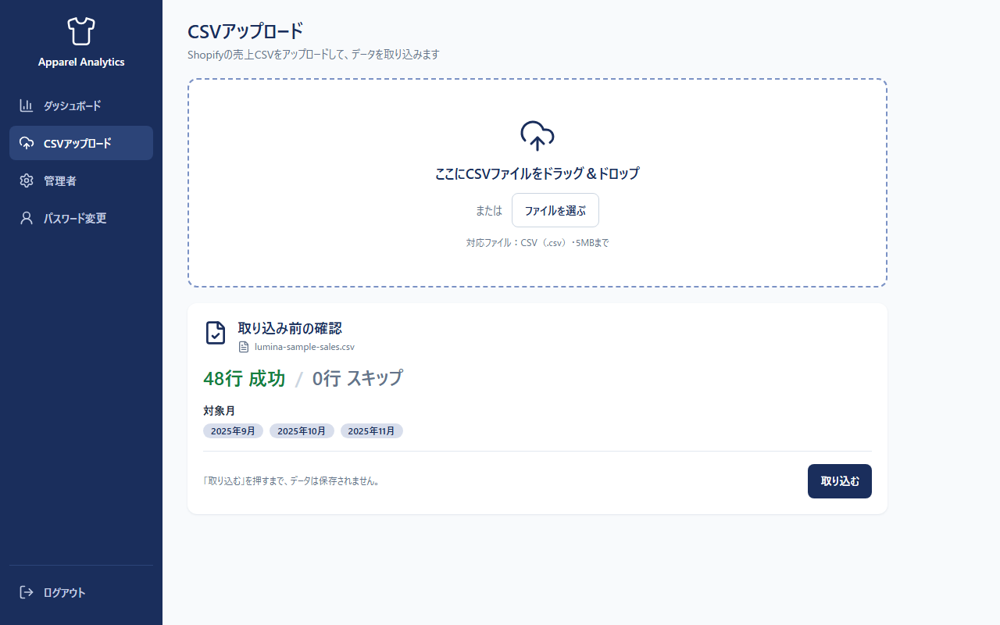
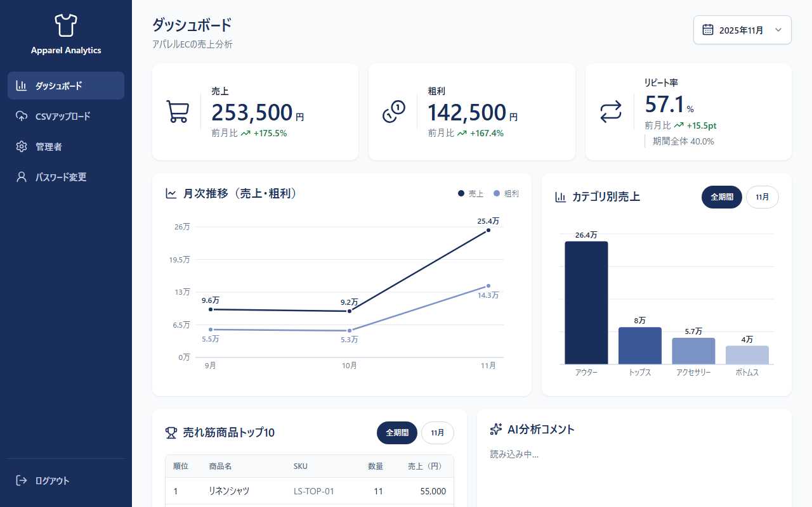
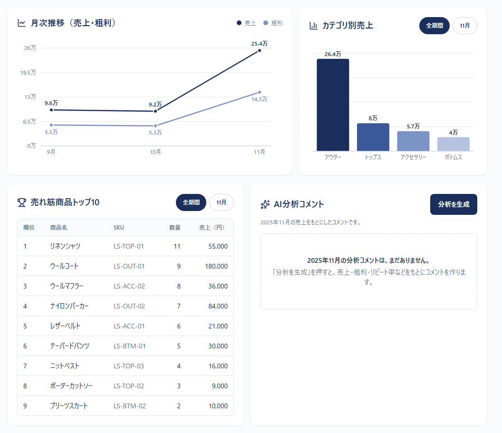
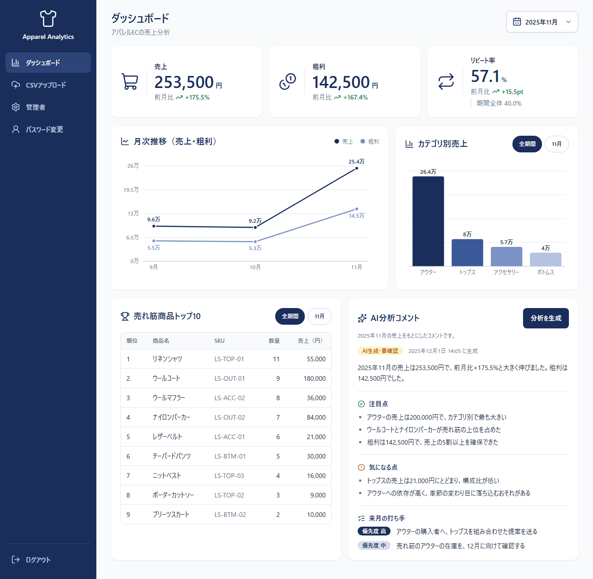
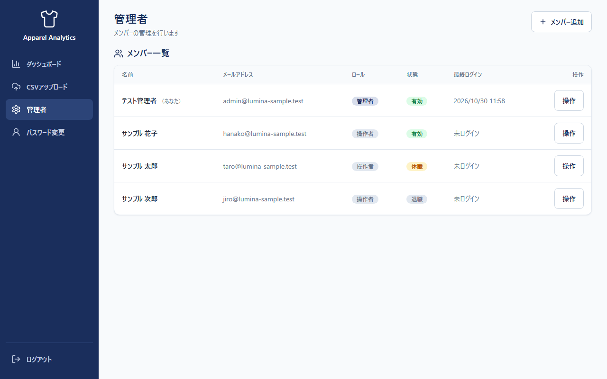
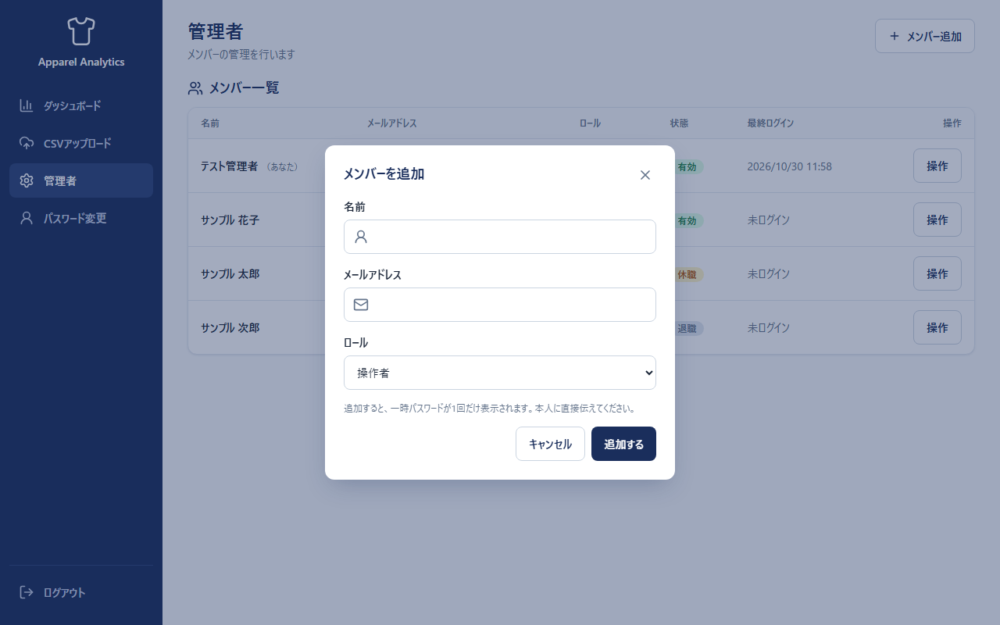
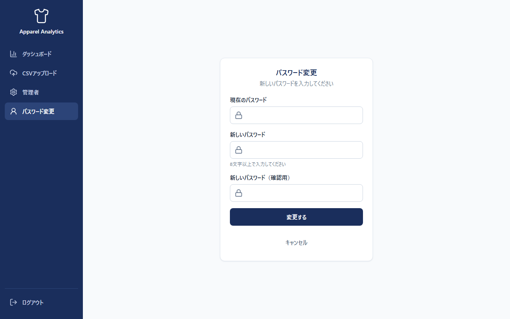
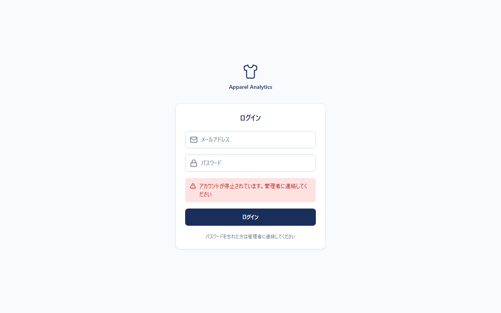

# 運用マニュアル（非エンジニア編）

アパレル EC「LUMINA」の売上分析ダッシュボードの使い方です。パソコンの基本操作ができれば、読みながらそのまま実行できます。

URL：管理者に確認してください（お使いの環境ごとに異なります）

この資料は「何をする → どう操作する → どうなれば OK」の形で書いています。1枚で手順だけ見たいときは、[印刷用の手順書（A4・1枚）](print/monthly-guide-a4.pdf) を使ってください（第10章）。

## 目次

1. このマニュアルについて
2. 画面の見かた
3. 毎月の手順（8ステップ）
4. AI コメントの扱い
5. 同じ月を取り込み直すとき
6. 管理者の操作
7. 管理者が交代するとき
8. 困ったとき
9. 用語の説明
10. 印刷して使う

---

## 1. このマニュアルについて

### 誰向けか

| 読む人 | 読む章 |
|---|---|
| 操作者（毎月のレポートを作る人） | 第2〜5章・第8章 |
| 管理者（メンバーを管理する人） | 第2〜8章すべて |

- 「操作者」と「管理者」は、アカウントごとに決まっている役割（ロール）です。管理者は、操作者にできることに加えて、メンバーの追加や停止ができます
- 保守担当（システムの設定や更新をする人）の手順は、このマニュアルには書いていません。保守担当の方は [developer-guide.md](developer-guide.md) を見てください

### 画面に出る 3 つの数字

| 数字 | 意味（一言で） |
|---|---|
| 売上 | 売れた金額の合計（円） |
| 粗利（あらり） | 売上から、商品の仕入れ値（原価）を引いた、お店に残る金額 |
| リピート率 | 2か月以上にわたって買ってくれたお客さまが、全体の何割か |

---

## 2. 画面の見かた

### ログイン画面

図① ログイン画面。メールアドレスとパスワードを入れて「ログイン」を押します。

- パスワードを忘れたときは、画面の案内どおり管理者に連絡します（第8章）

### 左のメニュー

ログインすると、画面の左にメニューが出ます（スマートフォンでは画面の下のタブ）。

| メニュー | 開くと何ができるか |
|---|---|
| ダッシュボード | 数字・グラフ・AI コメントを見る |
| CSVアップロード | 売上の CSV を取り込む |
| 管理者 | メンバーの管理（管理者だけに表示） |
| パスワード変更 | 自分のパスワードを変える |
| ログアウト | ログインを終える |

### CSV アップロード画面

図② CSV アップロード画面。点線の枠に CSV ファイルをドラッグするか、「ファイルを選ぶ」を押します。

### 取り込み前の確認

図③ 取り込み前の確認。「○行 成功 / ×行 スキップ」と対象の月が出ます。「取り込む」を押すまで、データは保存されません。

### ダッシュボード

図④ ダッシュボード。上に 3 つの数字のカード、その下にグラフ、右下に AI 分析コメントの欄があります。右上の欄で、見る月を選びます。

- 3 つのカードの「前月比」は、前の月と比べた増減です。リピート率の下の「期間全体」は、取り込んだすべての月をまとめた値です
- 「全期間」「11月」などの切り替えボタンで、グラフと売れ筋商品の表を、全期間の合計か選んだ月だけに切り替えられます

図⑤ グラフと表。月ごとの売上・粗利の推移、カテゴリ（商品の種類）別の売上、売れ筋商品のトップ 10 が見られます。

### AI 分析コメント

図⑥ AI 分析コメントが出た状態。「AI生成・要確認」の印と、生成した日時が付きます。

---

## 3. 毎月の手順（8ステップ）

所要時間の目安は約30分です。順番に進めてください。

### ステップ① 売上の CSV を用意する

- **何をする**：Shopify（ネットショップのシステム）から、その月の売上を CSV で書き出します。CSV は、表の内容をカンマで区切って並べた、Excel で開けるファイルです
- **どう操作する**：書き出したファイルの 1 行目（見出しの行）に、必要な 8 つの列名があるか確かめます。列名のルールは [CSV の形式の説明書](csv-format.md) にあります
- **OK の目安**：1 行目に「注文日・顧客ID・商品名・カテゴリ・SKU・数量・売上・原価」がそろっている

### ステップ② ログインする

- **何をする**：ダッシュボードにログインします
- **どう操作する**：URL を開き、メールアドレスとパスワードを入れて「ログイン」を押します（図①）
- **OK の目安**：ダッシュボードが開く

### ステップ③ CSV を取り込む

- **何をする**：用意した CSV を選びます
- **どう操作する**：左のメニューの「CSVアップロード」を開き、CSV ファイルを点線の枠にドラッグするか、「ファイルを選ぶ」で選びます（図②）
- **OK の目安**：「取り込み前の確認」に、「○行 成功 / ×行 スキップ」と対象の月が出る（図③）

### ステップ④ 取込結果を確かめて取り込む

- **何をする**：行数と対象の月が合っているか確かめ、取り込みます
- **どう操作する**：「スキップ」の行があるときは、「スキップ行をダウンロード」でスキップした理由を見ます。問題なければ「取り込む」を押します
- **OK の目安**：「○行を取り込みました。」と出る
- ⚠️ スキップが多いときは、取り込まずに CSV の列名・日付・数字の形式を直して、もう一度ステップ③からやり直します。直し方は [CSV の形式の説明書](csv-format.md) にあります

### ステップ⑤ ダッシュボードを見る

- **何をする**：対象の月の数字とグラフを見ます
- **どう操作する**：「ダッシュボードを見る」を押す（またはメニューの「ダッシュボード」）。右上の月の欄で、対象の月を選びます（図④）
- **OK の目安**：売上・粗利・リピート率の 3 つのカードと、グラフが出る

### ステップ⑥ AI 分析を生成する

- **何をする**：AI に、その月のコメントを作らせます
- **どう操作する**：「AI分析コメント」の「分析を生成」を押して、そのまま待ちます
- **OK の目安**：「分析を生成しました。」と出て、まとめ・注目点・気になる点・来月の打ち手が並ぶ（図⑥）

### ステップ⑦ AI コメントを確認し、必要なら直す

- **何をする**：AI が書いた内容が正しいか、人の目で確かめます
- **どう操作する**：コメントの中の金額や割合を、画面のカードの数字と見比べます。「数字を確認してください」という警告が出たら、一覧の数値を確かめます。確認のポイントは第4章にあります
- **OK の目安**：数字・解釈・打ち手に納得できる
- ⚠️ 画面の上ではコメントを編集できません。直したい箇所は、共有する資料の側（スライドやメールなど）で直します

### ステップ⑧ 社内に共有する

- **何をする**：確認し終えたレポートを共有します
- **どう操作する**：画面のスクリーンショットなどで共有します（見る人はログインしません）
- **OK の目安**：AI コメントを確認し終えた状態で、共有している

---

## 4. AI コメントの扱い

- コメントには必ず「AI生成・要確認」と出ます。人が確認してから共有するための印です
- AI は、集計した数字だけを受け取ります。お客さまの ID や、1 件ごとの注文の明細は送られません

### 確認する 3 つのポイント

| ポイント | どう確かめるか |
|---|---|
| 数字が合っているか | コメントの金額・割合を、カードの数字と見比べる。警告が出たら一覧の数値を見る |
| 解釈が納得できるか | 「なぜそう言えるのか」が、グラフや表から読み取れるか |
| 打ち手が使えるか | 来月の打ち手が、お店の状況に合っているか |

### 知っておくこと

- ⚠️ **画面には、その月の最新の AI コメントだけが出ます。** 「分析を生成」を押し直すと新しいコメントが表示され、前のコメントは画面に出なくなります。使いたいコメントは、生成のたびに文面を控えておいてください
- ⚠️ **同じ月の CSV を上書きすると、その月の古い AI コメントも消えます。** 上書きしたあとは、もう一度「分析を生成」を押します。残したいコメントは、上書きの前に控えておきます
- 生成に失敗したときは、数字とグラフはそのままで「時間をおいて、もう一度生成してください」と出ます。少し待ってからもう一度押します。無料の AI は 1 日に使える回数に上限があります

---

## 5. 同じ月を取り込み直すとき

すでに取り込んだ月の CSV をもう一度入れると、「上書きの確認」が出ます。

| 何をする | どう操作する | OK の目安 |
|---|---|---|
| 取り込み直す | 第3章のステップ③④と同じ手順で CSV を選ぶ | 対象月に「すでにデータあり」と出る |
| 上書きする | 「取り込む」→「上書きの確認」で「上書きする」を押す | 「○月のデータを上書きしました。」と出る |
| 上書きしない | 「上書きしない」を押す | 何も取り込まれない（古いデータも AI コメントもそのまま） |

- ⚠️ 上書きすると、その月の古い AI コメントも消えます（第4章）。残したい文面は、先に控えてください
- 1 つの CSV に複数の月が入っているとき、上書きしない月があれば、その CSV 全体が取り込まれません

---

## 6. 管理者の操作

管理者だけが、メニューの「管理者」を開けます。操作者には表示されず、URL を直接入れても開けません。

図⑦ 管理者画面（メンバー一覧）。右上の「メンバー追加」で人を増やし、各行の「操作」で変更します。「状態」の「有効」は使える人、「休職」「退職」はログインできない人です。

### メンバーを追加する

図⑧ メンバーを追加する画面。名前・メールアドレス・ロールを入れて「追加する」を押します。

| 何をする | どう操作する | OK の目安 |
|---|---|---|
| メンバーを追加する | 「管理者」→「メンバー追加」→ 名前・メールアドレス・ロールを入れて「追加する」（図⑧） | 一時パスワード（16文字）が出る |
| 一時パスワードを伝える | 「コピー」を押して、本人に直接伝える | 本人が控えた |
| 初めてログインしてもらう | 本人が一時パスワードでログインする | パスワード変更の画面（図⑨）が出る |

- ⚠️ **一時パスワードは、画面に出るのは 1 回だけです。** 閉じると二度と表示されません。コピーし損ねたら、もう一度「一時パスワードを再発行」します。DB（データの保管場所）にも記録にも残りません
- 一時パスワード（最初に 1 回だけ使う仮のパスワード）でログインした本人は、新しいパスワード（8文字以上）を決めるまで、ほかの画面を使えません

図⑨ パスワード変更画面。現在（一時）のパスワードと、新しいパスワードを 2 回入れて「変更する」を押します。

### そのほかの操作

| 何をする | どう操作する | OK の目安 |
|---|---|---|
| パスワードを忘れた人を助ける | メンバー一覧の「操作」→「一時パスワードを再発行」→「再発行する」 | 新しい一時パスワードが 1 回だけ出る。本人に直接伝える |
| 休職・退職にする | 「操作」→「状態を変更」→ 変更後の状態を選び、説明を読んで「変更する」 | 本人はログインできなくなる。データは消えない |
| 有効に戻す | 「操作」→「状態を変更」→「有効」 | 休職からは、これまでのパスワードで入れる。退職からは一時パスワードが同時に出るので、本人に伝える |
| ロールを変える | 「操作」→「ロールを変更」→ 管理者／操作者 | 変更したメッセージが出る |
| 名前・メールアドレスを直す | 「操作」→「名前・メールアドレスを編集」 | メールアドレスはログイン ID。変えるときは確認が出る |

- ⚠️ **一時パスワードを再発行すると、本人がほかの端末でログインしたままでも、パスワード変更の画面以外は使えなくなります。** 次に開いたときにパスワード変更へ送られます。「急に使えなくなった」と言われたら、再発行の直後かを確かめてください
- 自分自身は、状態やロールを変えたり、一時パスワードを再発行したりできません。自分のパスワードは、メニューの「パスワード変更」で変えます
- 有効な管理者が 0 人になる変更はできません
- 管理者の操作（追加・再発行・状態・ロール・編集）は、誰が・いつ・誰に・何をしたかが自動で記録されます（パスワードは記録されません。記録を見る画面はありません）

---

## 7. 管理者が交代するとき

アカウントは 1 人に 1 つです。使い回しません（操作の記録を、人ごとに正しく残すため）。

⚠️ **管理者は、2 人以上にしておくことをおすすめします。** 1 人だけだと、その人が辞めたりパスワードを忘れたりしたときに、メンバーの追加や一時パスワードの再発行ができる人がいなくなります。そうなったときは、保守担当に相談してください。

| 順番 | 誰が | 何をする | OK の目安 |
|---|---|---|---|
| ① | 前任の管理者 | 「メンバー追加」で後任をロール「管理者」で追加し、一時パスワードを伝える | 一時パスワードが出て、後任に伝えられた |
| ② | 後任の人 | 一時パスワードでログインし、自分のパスワードに変更する | ダッシュボードが開き、メニューに「管理者」がある |
| ③ | 後任の管理者 | 管理者画面で、前任を「退職」（または「操作者」）に変更する | 前任の状態が「退職」になる |

- 前任が退職した状態でログインしようとすると、「アカウントが停止されています」と出ます（図⑩）
- 引き継ぎができないまま、ただ 1 人の管理者に連絡が取れなくなったときは、画面からは直せません。保守担当に相談してください（保守担当向けの資料は [developer-guide.md](developer-guide.md#6-管理者がいなくなったとき) の第6章です）

---

## 8. 困ったとき

図⑩ 「アカウントが停止されています」の表示。休職・退職のアカウントでログインしたときに出ます。

| 出た表示・症状 | 原因 | 直し方 |
|---|---|---|
| 「必須の列が見つかりません」／全行がスキップ | CSV の列名が一覧にない | 1 行目の列名を直す（[CSV の形式の説明書](csv-format.md)） |
| 「AI分析を生成できませんでした」 | AI サービスの混雑、または 1 日の上限 | 時間をおいて、もう一度押す。数回続くときは保守担当へ |
| 「ログインの有効期限が切れました」 | ログインが切れた | 「ログイン画面へ」から入り直す |
| ログインできない | パスワードの入力違い | 入れ直す。忘れたときは、管理者に再発行を頼む（第6章） |
| 「アカウントが停止されています」（図⑩） | 休職・退職になっている | 管理者に連絡する |
| 急にパスワード変更の画面になった | 管理者が一時パスワードを再発行した | 新しいパスワードを決める（第6章） |

---

## 9. 用語の説明

| 用語 | 意味 |
|---|---|
| CSV | 表の内容をカンマで区切って並べたファイル。Excel で開ける。拡張子は `.csv` |
| ダッシュボード | 売上などの数字とグラフを、1 画面にまとめて見られる画面 |
| KPI | 仕事の成果を測る主な数字。このアプリでは、売上・粗利・リピート率 |
| 粗利（あらり） | 売上から原価を引いた金額 |
| リピート率 | 2 か月以上にわたって買ってくれたお客さまの割合 |
| 前月比 | 前の月と比べた増減 |
| ロール | アカウントの役割。「管理者」と「操作者」がある |
| 管理者 | メンバーの追加・停止などができる人 |
| 操作者 | CSV の取り込みとダッシュボードの閲覧ができる人 |
| 一時パスワード | アカウントを作ったとき・再発行したときに出る、1 回だけ使う仮のパスワード |
| 休職・退職 | ログインできない状態。データは消えない |
| スキップ | 形式が違って取り込めなかった行。理由つきの CSV で受け取れる |
| 上書き | すでにある月のデータを、新しい CSV の内容に置き換えること |
| AI 分析コメント | 集計した数字をもとに、AI が書くコメント。必ず人が確認する |

---

## 10. 印刷して使う

毎月の手順・AI コメントの確認・困ったときを、A4 の 1 枚にまとめた手順書があります。机の横に置いて使えます。

- 場所：[docs/print/monthly-guide-a4.pdf](print/monthly-guide-a4.pdf)

| 何をする | どう操作する | OK の目安 |
|---|---|---|
| PDF を開く | 上のファイルをダブルクリックして、PDF のビューア（またはブラウザ）で開く | 「毎月の売上レポート 手順書」が出る |
| 印刷の画面を開く | 「印刷」を押す（Ctrl + P） | 印刷の設定画面が出る |
| 設定する | 用紙サイズ：**A4**／倍率：**100%（拡大縮小なし）**／**片面** | プレビューが 1 枚に収まっている |
| 印刷する | 「印刷」を押す | 1 枚が出る |
| URL と連絡先を書く | 上の URL 欄と、下の連絡先の枠に、手で書き込む | 管理者・保守担当の連絡先が書いてある |

⚠️ 倍率を「用紙に合わせる」にすると、文字の大きさが変わります。「100%」または「実際のサイズ」にしてください。

保守担当の方は [developer-guide.md](developer-guide.md) を見てください。
